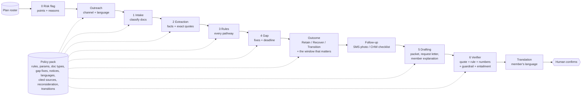

# Coverage Keeper

**Retain eligible members. Recover those dropped by mistake. Transition those who no longer qualify, so nobody falls into a gap.**

Insurers lose members to paperwork, not ineligibility. Our agents don't just remind members — they finish the paperwork.

| Outcome | Who | What Coverage Keeper does |
|---|---|---|
| **Retain** | Eligible members at risk of losing coverage | Find the pathway, catch missing evidence, draft the packet before the deadline |
| **Recover** | Members already dropped for paperwork | Inside the reconsideration window (90 days after termination under 42 CFR 435.916(a)(3)(iii)): count down the days left and draft the submission, so they may get coverage back without a new application |
| **Transition** | Members whose evidence suggests they may no longer qualify (income rose, turning 65, postpartum coverage ending, moved, no pathway) | List next-coverage options neutrally, compute the enrol-by date to avoid a gap (e.g. marketplace special enrollment, Medicare initial enrollment), and hand off to a navigator |

Coverage Keeper is an AI member-retention layer for health insurers. It finds members who are about to lose coverage over paperwork, reaches them in their language on the right channel, works out *which* compliance or exemption pathway their documents support, catches the missing evidence, drafts the response packet and the letter to the doctor/school/employer, and tracks the case to done. Every claim it writes is cited to a document line and a rule, and a verifier removes anything unsupported. A human always confirms before anything is sent.

> Built at Hackachusetts 2026 (BU DS+X), Oct 24 2026. **All data is synthetic.** "Maria" is an illustrative composite, not a real person.

## The problem

- In the 2023 Medicaid "unwinding", **72–73% of disenrollments were for procedural (paperwork) reasons** in states reporting reasons ([KFF](https://www.kff.org/medicaid/understanding-medicaid-procedural-disenrollment-rates/): "73% as of September 5, 2023"; "72% of disenrollments are due to procedural reasons" among states reporting as of Oct 11, 2023).
- From **January 1, 2027**, Massachusetts **Medicaid (MassHealth)** adds federal work/community-engagement requirements and six-month renewals for expansion adults (19–64). Massachusetts estimates **about 175,000 people** will lose MassHealth coverage under the new requirements and six-month checks (team brief). Many are exempt or compliant but will lose coverage over paperwork: they don't know they're exempt, send the wrong document, or miss the 30-day deadline.
- For a health plan (e.g. a Medicaid managed-care plan), **every eligible member lost is lost premium/capitation revenue** and broken continuity of care.

Outreach platforms (Ushur, Genesys, Blooming Health, Epiphany) send reminders. **Coverage Keeper finishes the paperwork.**

## What it does (demo: Maria)

Maria, 34, lives in Lawrence, speaks Spanish, and cares for her mother after a stroke. She is likely exempt as a caregiver of a person with a disability but doesn't know it. Her MassHealth letter arrives in English. Without help she would miss the 30-day deadline and lose coverage, and her diabetes prescriptions would stop.

1. **Plan view.** Maria is flagged at-risk (English notice / Spanish speaker, address change, missed notice, not reached in 90 days, possible caregiver exemption).
2. **Outreach.** A text message and a phone script in Spanish, each with the agency's direct contact line and an opt-out.
3. **Documents.** Her caregiver statement (Spanish photo) and her mother's neurology letter.
4. **Rules.** 17 pathways checked; the caregiver-of-a-disabled-individual pathway is supported but **needs evidence**.
5. **Gap caught.** The mother's doctor letter names the stroke but never states a disability or a daily-care need.
6. **Drafting.** A response packet on hold, a request to the mother's doctor quoting the federal definition, and a plain-language explanation in Spanish.
7. **Verifier log.** Every claim checked against an exact quote and a cited rule.
8. **Day 12.** The packet is ready; the plan keeps a member.

**Recover (Devon, illustrative composite, case C47).** Devon was dropped 20 days ago because a requested pay stub never arrived. The Outcome agent sees a procedural termination inside the 90-day reconsideration window: **70 days left**. It drafts a reconsideration submission with his September pay stubs (86 hours) and tells him, without promising, that he *may* get coverage back without reapplying.

**Transition (Kofi, illustrative composite, case C50).** Kofi reports a new full-time job and income above the limit. The tool doesn't compute the limit or decide anything. It says the evidence suggests he *may* no longer qualify, lists options neutrally (ask MassHealth to check every other way to qualify; the Massachusetts Health Connector), gives the enrol-by date to avoid a gap (2026-11-30) and the window end (2027-02-28, 90 days after loss of Medicaid under 45 CFR 155.420(c)(6)), and writes a warm hand-off note for a navigator.

## Architecture



- **Each stage is inspectable** in the UI: input/output JSON, engine (LLM or deterministic), model, latency and cost.
- **Models per stage** (`keeper/config.py`, set as `provider:model`). Three presets, picked automatically from the keys you have: an Anthropic key selects `anthropic`, otherwise an NVIDIA key selects `nvidia`, otherwise `free`.
  - **`nvidia`** runs every stage on open-weight models through NVIDIA NIM with one key (`NVIDIA_API_KEY`, free tier about 40 requests/min):
    - MiniMax M3.1 Flash for intake and the verifier.
    - Nemotron 3 Ultra for extraction, interpretation, drafting and translation.
    - Nemotron 3.5 Super VL for image transcription.
    - GLM 5.3 as the evaluation judge.

    The verifier and the judge are different model families from the drafter. These models were chosen because they answered a strict JSON-schema probe on 2026-10-24; several other catalog models returned 404 or timed out. Maria's case (C46) matches all its labels on this preset and takes about 3 minutes live.
  - **`free`** uses free API tiers spread over three providers:
    - Groq gpt-oss-20b for intake.
    - Gemini 3.8 Flash for extraction, translation, the verifier and image transcription.
    - Groq gpt-oss-120b for clinician-letter interpretation.
    - Cerebras gpt-oss-120b for drafting.
    - Cerebras Qwen 3.8 27B as the independent evaluation judge, a different model family from both the drafter and the verifier.
  - **`anthropic`** uses Haiku 5.5, Sonnet 5.5 and Opus 5.5.

  Stages pass JSON-schema structured outputs, and every response is re-checked against its schema locally.
- **Deterministic where possible:** thresholds, ages, dates, deadlines and pathway logic are code. The LLM handles interpretation (does this letter say the condition impairs the ability to work?), extraction from messy documents, drafting and translation.
- **Run modes:** `live` calls the API and caches every response on disk. `replay` serves cached responses only (demo-safe, works offline). `offline` uses deterministic engines only. Every LLM stage falls back to its deterministic engine on network failure, so the demo never dies.

### Policy packs (insurer-agnostic)

All program-specific content lives in `packs/<id>/`: scope, pathways and thresholds (as generic evaluator + parameters), exemptions and required evidence, gap codes with fixes and member-facing text, deadlines and process rules, document types and classifier keywords, notice conventions, languages, and the rulebook with source URLs and verbatim quotes. The agents read the active pack; no program specifics live in agent logic or prompts.

| Pack | Line of business | Status |
|---|---|---|
| `masshealth_ce_2027` | Medicaid (MassHealth expansion adults) | 23 rules; 22 quoted verbatim from the CMS interim final rule (42 CFR 435.550–563) and machine-checked against the downloaded text; ambiguous rules marked `needs_confirmation` |
| `georgia_pathways` | Medicaid (Georgia Pathways to Coverage, Section 1115 demonstration) | **Real policy.** Adults 19–64 must log 80 hours a month of qualifying activities, with no general exemptions; college credit hours count in tiers and so does being the parent of a child under 6. 18 rules: the Georgia ones are quoted word for word from the Georgia DCH copy of the Special Terms and Conditions, the 2025 Pathways FAQ and georgiaaccess.gov, and machine-checked; 9 are marked to confirm, and the response window is a placeholder. |
| `employer_dependent_audit_demo` | Employer / commercial plan | **ILLUSTRATIVE, made-up rules**, labelled as such in the UI. Shows the same agents running on a different program (dependent under 26, 60-day window). |

Pick a pack on the **Policy packs** page (or in any case's header) and case pages and new runs use it; each case keeps a separate saved run per pack. For any pack other than MassHealth, the page shows **what would change for the 54 dataset members**: every case is run under both packs by the rules engine in about a second, and each member is listed as losing their pathway, gaining one, getting a different outcome or keeping the same result, with a link to their full summary under the new policy. Under Georgia Pathways, 25 members lose the pathway their documents support (frailty, caregiving, pregnancy, SNAP, veterans, foster care, recent release, tribal membership, income and half-time study don't count there), and 31 instead of 8 are routed to new coverage.

The MassHealth pack also has a `reconsideration` section (window length, what to submit, reinstatement note, citations) and a `transitions` section (triggers → next-coverage options, enrolment window rules, documents, citations, neutral-routing note). The Outcome agent reads only these; a pack without them simply has no Recover/Transition.

New lines of business (Medicare Advantage, ACA marketplace re-enrollment, non-US private insurers) are new packs, not new code.

## How to run

```bash
pip install -r requirements.txt
python data/generate_cases.py      # 46 synthetic cases with labels
python data/generate_roster.py     # 200-member synthetic plan roster (calibrated to CMS + ACS data, see below)
python data/render_documents.py    # realistic synthetic PDFs + page images (watermarked "SYNTHETIC SAMPLE")
python server.py                   # http://127.0.0.1:8000
```

`python data/fetch_calibration.py` re-downloads the public CMS and Census data and rewrites `data/calibration/ma_calibration.json`. You only need it to refresh the data: the JSON is committed, so the roster generator runs offline.

- **Live LLM mode (free APIs):** each person uses their own keys. Copy the template and fill in your keys:

  ```bash
  cp .env.example .env              # Windows PowerShell: Copy-Item .env.example .env
  # then edit .env: either NVIDIA_API_KEY=... (all stages, one key)
  #                 or GROQ_API_KEY=..., GEMINI_API_KEY=..., CEREBRAS_API_KEY=...
  ```

  - `.env` is git-ignored and never committed. Keys already set as system environment variables take precedence over it.
  - All three providers have free tiers, and no local model is needed.
  - A stage whose provider has no key falls back to its deterministic engine, so one key is enough to start.
  - Override any stage with `PP_MODEL_<STAGE>=provider:model`. Providers: `groq`, `gemini`, `cerebras`, `openrouter` (free models end in `:free`), and `custom` for any other OpenAI-compatible endpoint via `PP_CUSTOM_BASE_URL` and `PP_CUSTOM_API_KEY`.
  - To use Claude instead, set `ANTHROPIC_API_KEY`, or `PP_MODELS=anthropic`.
  - Without any key the app runs in `replay` mode: cached responses if present, otherwise deterministic engines.
- **Free-tier limits:** requests are paced per provider (`PP_RPM_<PROVIDER>`), and Groq's completion budget is capped to fit its tokens-per-minute limit (`PP_MAX_TOKENS_<PROVIDER>`). If a provider's daily quota runs out mid-run, the affected stages fall back to deterministic. Responses are cached, so re-running `--llm` the next day resumes where it stopped. Free tiers may retain prompts, so use them with synthetic data only.
- **Evaluation (one command):** `python eval/run_eval.py` (deterministic) or `python eval/run_eval.py --llm` (LLM agents + independent judge; cached, so re-runs are free). Results go to `eval/RESULTS.md` (the website has no evaluation tab).
- **Demo safety:** after one `--llm` run, every response is cached in `cache/`, so `PP_MODE=replay python server.py` replays the demo without network.
- **Check the rulebook quotes:** `python scripts/check_rulebook_quotes.py` confirms every "fetched_verbatim" quote appears in the downloaded Federal Register / SHVS text.

## Evaluation

54 synthetic cases (27 dev / 27 test, alternating so every scenario family appears in both). Each is labelled Retain, Recover or Transition, and the Recover/Transition cases also carry the expected key date (reconsideration end, or the last day to enrol in next coverage). Hard cases: frailty letters that do or don't state the impact on work, behavioral-health and SUD frailty, stable recovery (excluded), a child aged 13 vs 14, postpartum at the 12-month boundary, 75 hours + less-than-half-time classes, gig income at $571 / $580 / $596, conflicting documents, a 65-year-old and a Medicare member (out of scope), Spanish and Portuguese documents, stale pay stubs, tipped wages, and cases with no qualifying pathway. Recover: dropped 20 days ago (inside the window), 120 days ago (window closed), and dropped but now pregnant (exempt). Transition: income rose above the limit, postpartum coverage ending, turning 65 next month (Medicare), moved out of state, and no pathway or exemption.

Every case document is also rendered as a realistic, watermarked PDF (letterheads, pay-stub forms, handwritten-style statements, ID cards). **Robustness check:** reading text back out of those PDFs with naive extraction dropped the deterministic engine from 46/46 to 28/46 (form labels and values split onto separate lines). Layout-aware extraction (`keeper/docs.py: pdf_to_text`) restores full accuracy (now 54/54) (`python scripts/smoke_pdf.py`).

Headline numbers on the **held-out test split**. The current table is in [`eval/RESULTS.md`](eval/RESULTS.md).

| Run | n | Top-1 | Top-2 | Sufficiency | Gap P | Gap R | Retain / Recover / Transition | Key date | Transition told "still eligible" | Unsupported claims | Latency | Cost |
|---|---|---|---|---|---|---|---|---|---|---|---|---|
| Deterministic baseline, verifier off | 27 | 100% | 100% | 100% | 100% | 100% | 100% | 100% (n=4) | 0% (n=4) | 0/429 (0%) | 3 ms | $0 |
| Deterministic baseline, verifier on | 27 | 100% | 100% | 100% | 100% | 100% | 100% | 100% (n=4) | 0% (n=4) | 0/429 (0%) | 3 ms | $0 |
| LLM agents, verifier off / on | 27 | *run `--llm`* | | | | | | | | *headline ablation* | | |

On all 54 cases (`--split all`): outcome classification 100%, key date 100% (n=8), transition cases told they are still eligible 0% (n=8). "Told still eligible" counts a transition case whose member explanation uses retain framing ("you may qualify through…", "your documents look complete") or that gets a ready packet.

**Read these honestly.** The deterministic engine was written alongside the synthetic document templates, so 100% is an upper bound on template-like documents, not evidence of generalisation. Its drafts are built from grounded facts, so they are supported by construction. The verifier ablation matters for the **LLM drafter**: `--llm` measures unsupported claims in raw LLM drafts vs after the verifier, judged by grounding checks plus an independent entailment judge from a different model family.

**Risk flagging** (200 synthetic members, 51 labelled would-lose-for-paperwork):

| Method | P@20 | R@20 | P@40 | R@40 | P@60 | R@60 |
|---|---|---|---|---|---|---|
| Coverage Keeper risk points | 80% | 31% | 62% | 49% | 58% | 69% |
| Soonest deadline first | 15% | 6% | 28% | 22% | 25% | 29% |
| Random | 35% | 14% | 20% | 16% | 25% | 29% |

The labels come from a synthetic latent model using the same feature families, and the hand-set points were *not* fit to them. This tests ranking under assumed dynamics, not real-world accuracy.

**The roster is synthetic but calibrated to real public data.** Real member-level Medicaid records are protected health information, so no real member appears anywhere. The roster's aggregate shape comes from published, area-level data (`data/calibration/ma_calibration.json`, built by `data/fetch_calibration.py`):

| Roster parameter | Real source | Value |
|---|---|---|
| Share of members who must respond (not verified automatically) | CMS renewal outcomes, MassHealth, renewals due May 2023–Mar 2024 (1.44M): share *not* renewed ex parte | 67.0% |
| Label base rate among them | Same data: procedural terminations ÷ renewals that needed a form | 45.4% (monthly range 23–58%) |
| City mix (10 MA cities) | ACS 2020–2024 5-year, C27007: Medicaid-covered adults 19–64 per city | Boston 29%, Springfield 13%, Worcester 12%, … Chelsea 4% |
| Preferred language by city | ACS C16001 (city) + B16001 (PUMA, to split out Haitian and Portuguese): residents who speak English less than "very well" | e.g. Lawrence 40% Spanish, Brockton 10% Haitian Creole, Fall River 10% Portuguese |

The generator solves the latent model's intercept so the expected label rate among members who must respond matches the CMS rate. This roster's realised rate is 39% (50 of 127), a sampling-noise gap at this n. Caveats:
- Unwinding renewals are a proxy for 2027 community-engagement verification.
- Procedural terminations include some people who were really ineligible, so the label rate is an upper-bound proxy for "eligible but lost to paperwork".
- ACS language data covers all residents, not MassHealth members, so language mismatch is probably understated.
- Returned mail, address changes, contact history and exemption hints are still assumptions.

The calibration also shows where the product needs to grow. In Lowell, 9% of residents have limited English in a language the tool doesn't support yet, mostly Khmer (27% of Lowell's limited-English residents).

**Fairness:** results are broken down by member language, case type and outcome (Retain / Recover / Transition) in `eval/RESULTS.md` and in the UI.

## Responsible AI and guardrails

- **Never decides eligibility.** The tool says "likely pathway" and "documents support". The verifier strips decision language ("is eligible", "is exempt", "approved", "guaranteed"). Packets stay drafts until a coordinator ticks a confirmation box.
- **Citations on every claim.** Each sentence is a typed claim (fact / finding / rule / request) carrying a document quote and/or a rule ID. The verifier checks that the quote is present verbatim, the rule exists, every number appears in the support, there's no decision language, and (live mode) that the LLM entailment check passes. Removals are logged and shown.
- **Ambiguity shown, not guessed.** Medical-frailty letter requirements, postpartum length (placeholder 12 months), "part-time" vs "half-time", accepted caregiving documentation, the 45-day renewal form, and day counting for the 30-day window are all marked `needs_confirmation` in the UI.
- **What leaves the machine.** Synthetic data only. In live mode, document text goes only to the API calls of the configured model providers: Groq, Google Gemini and Cerebras in the `free` preset, or Anthropic in the `anthropic` preset. Free tiers may retain prompts or use them to improve models, which is acceptable only because all data here is synthetic. Nothing goes to other third parties, and document contents aren't logged. The cache and navigator-entered cases are local and git-ignored. Offline/replay mode sends nothing.
- **Fairness.** Evaluation is reported by language and case type.
- **No dark patterns.** Outreach always gives the agency's direct contact line and a text opt-out, never asks for an SSN by text, and never implies a decision.
- **Recover without false promises.** Dropped members are told they *may* get coverage back without a new application, by a dated deadline, and that the agency decides. Nothing says coverage will be reinstated or backdated (the MassHealth reinstatement waiver couldn't be fetched, so it's marked `needs_confirmation`).
- **Neutral routing on transition.** The tool says the evidence suggests the member *may* no longer qualify; it never decides. Next-coverage options are listed without preference and the member chooses. Plan contracts may bar steering members to the plan's own marketplace product, so options are never ranked. A navigator confirms through a warm hand-off.
- **Risk flags only help.** The score is a transparent points list with reasons. It only orders who is offered help first, and is never used to deny, delay or deprioritise coverage or services.
- **Human in the loop.** Coordinators and navigators review everything. Machine-drafted translations are labelled for native-speaker review.

## Limitations

- Synthetic data, small n (46 cases; one case is about 4 points). No real documents, OCR noise or adversarial inputs at scale. The roster's base rates and city/language mix are calibrated to public CMS and ACS aggregates, but the member-level dynamics behind the risk labels are assumed.
- mass.gov pages returned HTTP 403 to automated clients, so MassHealth-specific wording ($580 in MassHealth's own words, "part-time", the 45-day renewal form, the blue envelope) comes from the team brief and is marked `needs_confirmation`. Federal rules are quoted verbatim from 91 FR 33348.
- The deterministic baseline is template-tuned (see above). The LLM run is the generalisation test.
- Offline translations are machine-drafted templates. Live mode uses Claude, but either way a native speaker should review.
- We deliberately leave income verification to CMS's Emmy and vendors. For income/hours cases we only check the documents provided against the thresholds.
- Recover/Transition windows use federal rules: 90-day reconsideration (42 CFR 435.916(a)(3)(iii); a state may elect longer), marketplace special enrollment after losing Medicaid (90 days after, up to 60 days before; 45 CFR 155.420(c)(2),(c)(6)), Medicare initial enrollment (42 CFR 407.14). How MassHealth and the Health Connector apply them, ConnectorCare income limits, and whether reinstatement is backdated were not verifiable and are marked `needs_confirmation`; no income limits are encoded (income-change transitions rely on a member-reported change). The Delaware worked example returned HTTP 404 and the MassHealth waiver letter HTTP 403. The brief cited 435.916(b)(2)(iii); the current eCFR places the rule at (a)(3)(iii).
- Recover/Transition member text exists in English and Spanish; other languages fall back to English (labelled) offline, or AI translation in live mode.
- Plan-view Recover/Transition members (M0201–M0220) and their statuses and hand-offs are synthetic; the 200 calibrated members and the risk evaluation are unchanged.
- The capitation figure in the plan view ($600 PMPM) is an illustrative assumption, not a sourced number. Case statuses in the plan view are synthetic.

## Sources

- CMS interim final rule, *Medicaid Program; Community Engagement Requirement for Certain Individuals*, 91 FR 33348 (June 3, 2026): https://www.federalregister.gov/documents/2026/06/03/2026-11094/medicaid-program-community-engagement-requirement-for-certain-individuals (full text fetched via the federalregister.gov API)
- SHVS / Manatt, *Medicaid Work Reporting Requirements: Verifying Compliance and Exemptions*: https://shvs.org/resource/medicaid-work-reporting-requirements-verifying-compliance-and-exemptions/
- KFF, *Understanding Medicaid Procedural Disenrollment Rates*: https://www.kff.org/medicaid/understanding-medicaid-procedural-disenrollment-rates/
- CMS, *Medicaid and CHIP Updated Renewal Outcomes* (roster calibration, Massachusetts rows): https://data.medicaid.gov/dataset/e6205a51-e6d7-4849-9882-4483b8a28c41
- US Census Bureau, ACS 2020–2024 5-year summary file, tables C16001, B16001 and C27007 (roster calibration): https://www.census.gov/programs-surveys/acs/data/summary-file.html
- eCFR 42 CFR 435.916 (reconsideration at (a)(3)(iii)), fetched via the eCFR API: https://www.ecfr.gov/current/title-42/chapter-IV/subchapter-C/part-435/subpart-J/section-435.916
- eCFR 45 CFR 155.420 (special enrollment periods): https://www.ecfr.gov/current/title-45/subtitle-A/subchapter-B/part-155/subpart-E/section-155.420
- eCFR 42 CFR 407.14 (Medicare initial enrollment period): https://www.ecfr.gov/current/title-42/chapter-IV/subchapter-B/part-407/subpart-B/section-407.14
- Massachusetts Health Connector: https://www.mahealthconnector.org/
- Not fetchable (listed for reference, rules marked `needs_confirmation`): MassHealth 1902(e)(14)(A) reinstatement-during-reconsideration waiver approval (HTTP 403); Delaware DHSS 90-day reconsideration notice (HTTP 404).
- MassHealth pages (not fetchable, HTTP 403; listed for reference): new work and education requirements, screener, federal updates, Sept 2026 stakeholder presentation; CMS Medicaid eligibility.

## Repo layout

```
server.py                 FastAPI app + SSE pipeline stream
static/                   UI: Today, Members, case pages (Summary, Documents, Letters, Evidence,
                          How it was decided), Policy packs, Safeguards; original UI at /classic
keeper/                   core agents (program-agnostic)
  pipeline.py             orchestrator + trace
  risk.py  plan.py        risk flagging, plan view
  stages/                 outreach, intake, extract, rules, gaps, draft, verify
  llm.py                  Anthropic + OpenAI-compatible clients, JSON schemas, disk cache, cost
packs/                    policy packs (rules.json with cited quotes + pack.json)
data/                     synthetic case + roster generators; calibration/ holds the CMS + ACS aggregates
eval/run_eval.py          one-command evaluation -> eval/RESULTS.md
docs/                     demo script, Devpost text, slide outline
```
